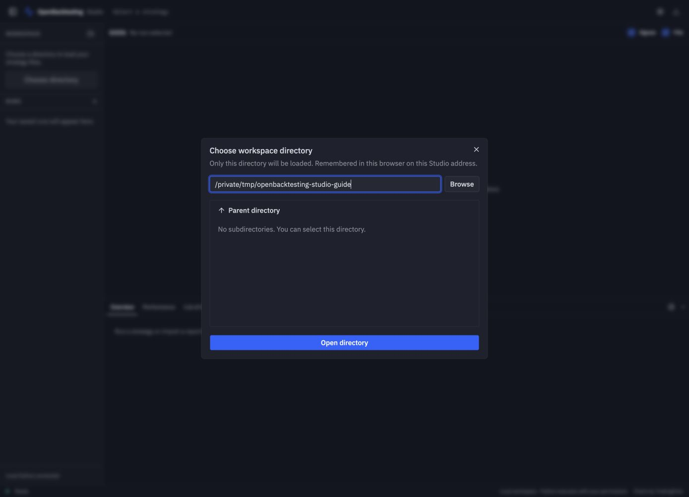
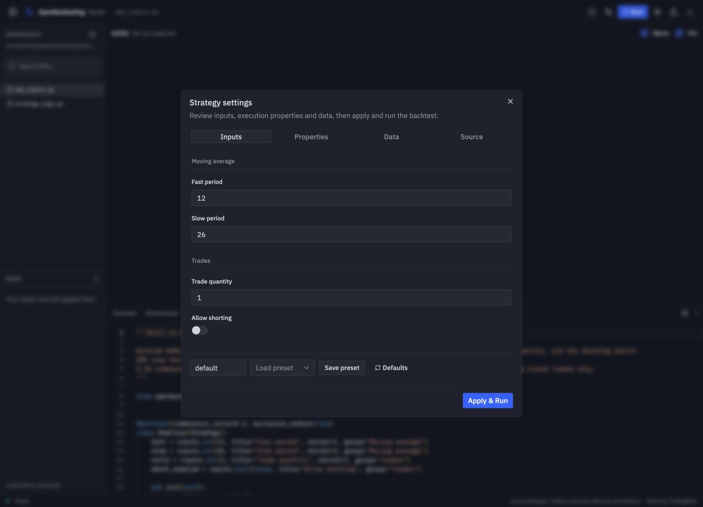
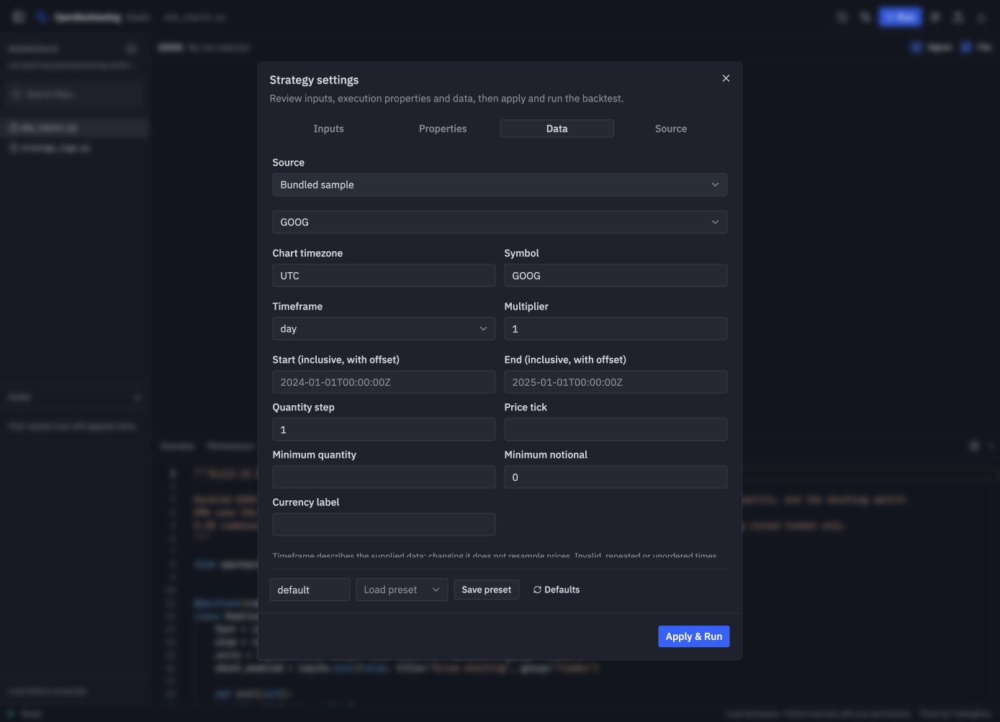
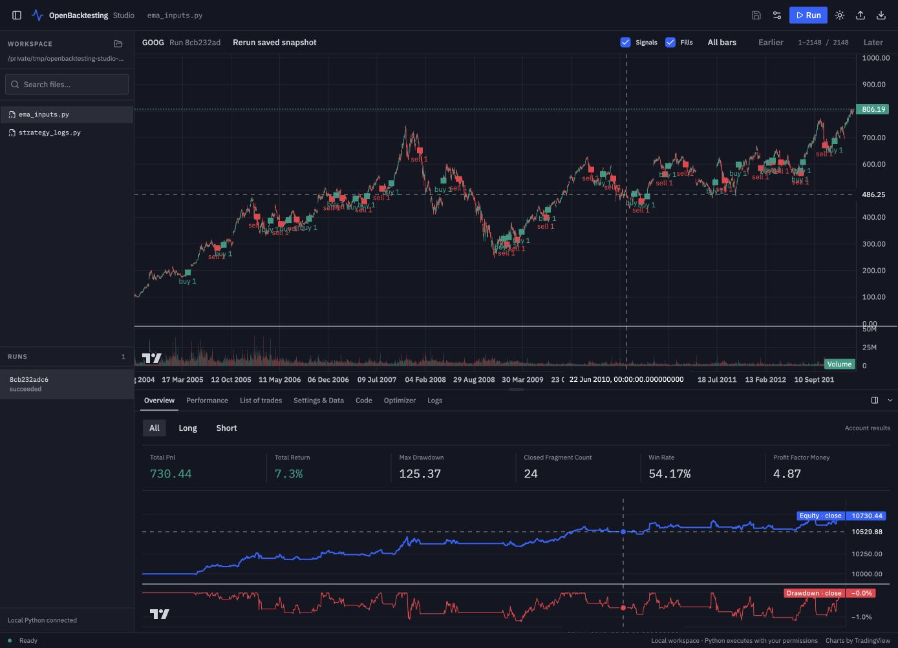
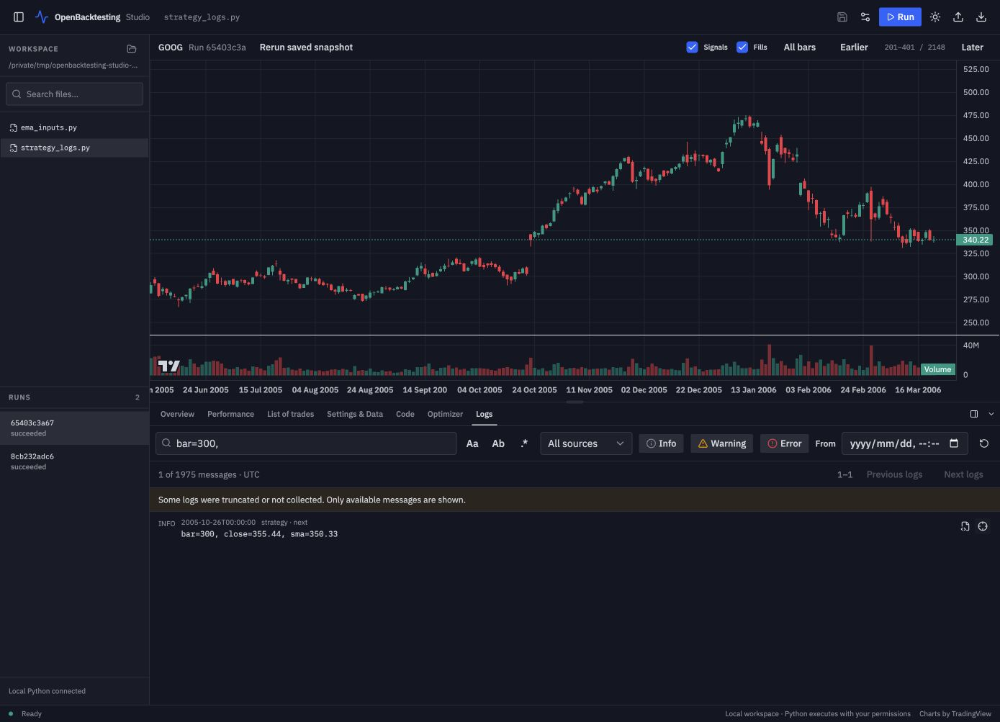
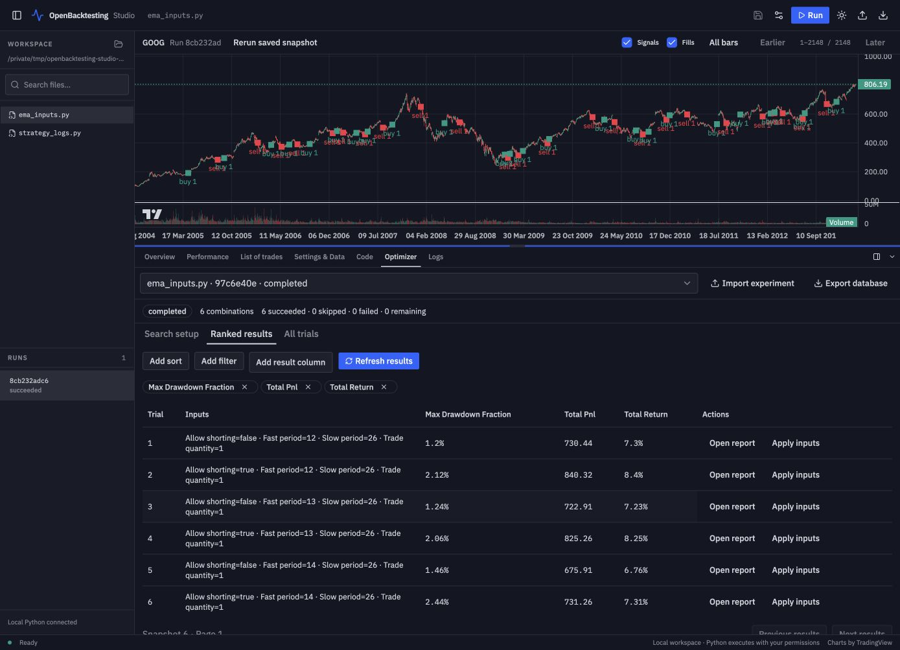

# OpenBacktesting Studio

Studio is the optional browser interface for OpenBacktesting. Edit local Python files, change strategy inputs, run backtests, and inspect charts, trades, logs, and parameter experiments in one workspace. The Python framework works independently: installing `openbacktesting` alone does not install Studio or its web assets.

Click any screenshot to open it at full size.

## 1. Install and launch

These instructions target the Studio source checkout. They do not assume that `openbacktesting-studio` has been published on PyPI. Use Python **3.12–3.14**; the current Studio has been exercised on **macOS**. Linux and Windows have not been verified, and workspace file protection currently uses POSIX directory descriptors.

### From a source checkout

Start at the root of an OpenBacktesting checkout containing the `studio/` directory. Building the web assets requires **Node.js 22.12+** and npm. Ensure `python --version` reports a supported version, then create an isolated Python environment, build the assets, and install both local packages together:

```sh
python -m venv .venv-studio
source .venv-studio/bin/activate
python -m pip install --upgrade pip
npm --prefix studio/web ci --ignore-scripts
npm --prefix studio/web run build
python -m pip install . ./studio
openbacktesting-studio examples/strategies
```

The build compiles the vendored chart library and packages the interface and editor worker. The Python installation rejects missing or stale frontend assets. Run the frontend build again after changing interface code. For editable Python development, replace the install command with `python -m pip install -e . -e ./studio`.

### From built packages

If you have the matching core and Studio wheels, install them into the same Python environment. This route needs **no Node.js or npm**:

```sh
python -m pip install /path/to/openbacktesting-0.2.0-py3-none-any.whl /path/to/openbacktesting_studio-0.1.0-py3-none-any.whl
openbacktesting-studio /path/to/strategies
```

Built Studio wheels and source distributions include the compiled interface; the running application loads its assets locally, without a CDN. Your strategy's additional Python dependencies must be installed in its interpreter.

Studio opens the default browser. To choose the browser yourself, use `--no-open`, then open the **complete URL printed by the terminal**, including the one-time `#token=…` fragment. The default address uses `127.0.0.1:8765`. Keep the terminal running; press **Ctrl+C** there to stop the server.

```sh
openbacktesting-studio /path/to/strategies --no-open
```

An occupied port produces an error. Stop your own previous Studio process or choose another fixed port with `--port 8766`. `--port 0` chooses a temporary port. To use another interpreter, pass `--python /absolute/path/to/python`; install compatible core and Studio packages there first.

## 2. Choose your workspace

On first use, select a directory in **Choose workspace directory**. Browse folders or enter an absolute path and click **Open directory**. The CLI directory is a starting location for the picker, not permission to automatically load every file in the current directory.

[](../_static/studio/choose-workspace.png)

*The screenshots use an isolated directory containing copies of the repository's example strategies. Your directory path and run IDs will differ.*

Studio remembers the chosen path in browser localStorage (`studio.workspace`). Reloading or restarting at the same address restores it. A different port, hostname, browser profile, or cleared browser storage has separate preferences. If the directory no longer exists, choose another one.

Use the folder button beside **Workspace** to switch directories after saving edits and finishing or cancelling active work. Search the file list by name or path. Each directory keeps its own run history.

## 3. Run your first strategy

For the source-checkout walkthrough, choose `examples/strategies`, then search for and open **ema_inputs.py**. This example declares a single `@backtest` strategy with configurable EMA periods and order quantity. A script that only calls `Backtest(...).run()` is not automatically a Studio strategy; see [decorator and runtime](../reference/runtime.md).

1. Click **Run**. The first run opens **Strategy settings** for review.
2. In **Inputs**, keep Fast period **12**, Slow period **26**, Trade quantity **1**, and Allow shorting off. Keep the fast period below the slow period.
3. In **Properties**, review cash, commissions, sizing, and execution behavior.
4. In **Data**, keep **Bundled sample → GOOG**, UTC, and day × 1. No market-data download is needed.
5. Click **Apply & Run**. Wait for the run to become **succeeded** and the report to appear.

[](../_static/studio/strategy-inputs.png)

[](../_static/studio/data-settings.png)

For your own data, select **Workspace CSV** and specify its path, time column, OHLCV columns, time encoding, and source timezone for naive timestamps. **Local Python loader** accepts a function that returns a DataFrame. See [market data](../guides/data.md) for DataFrame and timestamp requirements. Changing the timeframe label does not resample prices.

## 4. Read charts and results

[](../_static/studio/backtest-results.png)

The chart shows the selected run's saved data. **Signals** and **Fills** control separate layers; **All bars**, **Earlier**, and **Later** change the displayed window. Indicator declarations determine which series appear on the main chart or secondary panes. Click a trade's location action to inspect its original execution.

| Tab | What to inspect |
| --- | --- |
| **Overview** | Headline metrics and the equity curve |
| **Performance** | Detailed metrics and All / Long / Short contributions |
| **List of trades** | Trades and execution tables, record details, and chart locations |
| **Settings & Data** | The configuration and data identity saved for this run |
| **Code** | The selected workspace file or an explicitly opened source snapshot |
| **Optimizer** | Saved parameter experiments and their trial reports |
| **Logs** | Strategy messages, worker output, and errors |

Use the panel icon beside the tabs to move results **below the chart or to its right**. Drag the divider to resize; focus it and use arrow keys for keyboard resizing. Placement and size are remembered. Collapsing the panel does not discard its state.

Select a completed entry under **Runs** to reopen its saved report and chart without executing the strategy again. **Rerun saved snapshot** explicitly creates a new run from captured source and data when those resources are available. **Out of date** means the displayed run differs from the current source or configuration; it does not invalidate the saved result.

## 5. Edit code and change parameters

Open **Code**, edit, and use **Save strategy** or **Ctrl/Cmd+S** while the editor is focused. Saving writes to the actual local Python file. If the file changed elsewhere, resolve the conflict before saving; failed saves retain your draft. An opened historical source snapshot is read-only.

Open **Strategy settings** to change **Inputs** without editing the Python declarations. **Apply to next run** updates the next configuration; it does not start a backtest. Click **Run** when ready. If code has unsaved changes, **Save & Run** saves before preparing the new run. A new or changed input schema may require review again.

**Save preset** stores reusable inputs and properties as JSON; **Save profile** stores a data configuration. Neither rewrites the strategy's default values. Every submitted run keeps an immutable configuration, so later edits do not change its result.

## 6. Inspect logs

Run the bundled `strategy_logs.py` example to explore **Logs**. Messages show timestamps, levels, and sources. Filter by Info / Warning / Error, source, or starting date; search supports case sensitivity, whole words, and regular expressions. A truncation notice means only the available messages are shown.

[](../_static/studio/strategy-logs.png)

The source icon opens the captured code at its recorded line. The bar icon locates the corresponding original bar without running Python. These actions depend on the snapshot resources being available. Logs are saved backtest output, not a live log stream.

## 7. Compare parameters with Optimizer

Return to `ema_inputs.py` and review its settings, then open **Optimizer**, immediately after **Code**:

1. In **Search setup**, enable Fast period. Keep its first value at `12`, then use **Add Fast period value** twice to enter `13` and `14` in separate fields; keep Slow period at 26. Enable Allow shorting and use **Add Allow shorting value** to include both `false` and `true`. This creates six combinations.
2. Click **Preview search** to capture source, settings, and normalized data and inspect the planned combinations. Preview can import strategy code and load data, but does not execute `init()` or `next()`.
3. Click **Start experiment**. You can cancel and resume using the frozen inputs; regular runs and optimization share one execution slot.
4. In **Ranked results**, choose columns, add sorts or filters, and click **Refresh results**. **All trials** includes skipped and failed combinations.
5. Use **Open report** for the saved Portfolio, or **Apply inputs** to review a trial's parameters for the next regular run.

[](../_static/studio/optimizer-results.png)

Optimization currently saves Portfolio reports, **not per-trial plots or logs**. Apply a trial's inputs and run a regular backtest when you want its chart. **Export database** creates a consistent SQLite backup; **Import experiment** opens it for querying and reports, without executing or resuming imported code. See [parameter experiments](../guides/optimizer.md) for core search and query semantics.

## Save, share, and reopen

Studio stores history, snapshots, profiles, and experiments under `.openbacktesting/studio/` inside the chosen directory. Keep that directory to retain your history; consider ignoring it in your strategy repository.

**Export result** creates an `.obstudio` archive. Reports, chart data, and provenance are included by default; source, normalized raw data, and logs are opt-in. Review the contents before sharing. Use **Import result** in Studio, or launch a read-only viewer:

```sh
openbacktesting-studio view /path/to/result.obstudio --no-open
openbacktesting-studio view /path/to/portfolio.json --no-open
```

A standalone Portfolio JSON provides reports; it does not imply that chart data is present. Imported results do not execute embedded Python.

Studio runs trusted local Python with your user permissions; it is not a sandbox.

## Troubleshooting

| Symptom | What to check |
| --- | --- |
| `openbacktesting-studio` is not found | Activate the environment where Studio is installed; `python -m openbacktesting_studio.cli --help` checks that interpreter directly. |
| Installation rejects static assets | Run `npm --prefix studio/web run build` from the checkout root, then retry the Python install. |
| No compatible strategy is discovered | The saved module must expose one `@backtest` strategy; install its imports into the selected interpreter. |
| A run fails or data is rejected | Open **Logs** and inspect the source location; check column mappings, time encoding, timezone, and ordered unique bars. |
| Directory switching is disabled | Save unsaved code and finish or cancel the active run or optimization. |
| An old result has no chart or source | Those resources were not included. Read the report, or explicitly run locally trusted source to create a new complete result. |
| The remembered directory disappears | Use the same browser profile and origin, including the port, and check that the directory still exists. |
