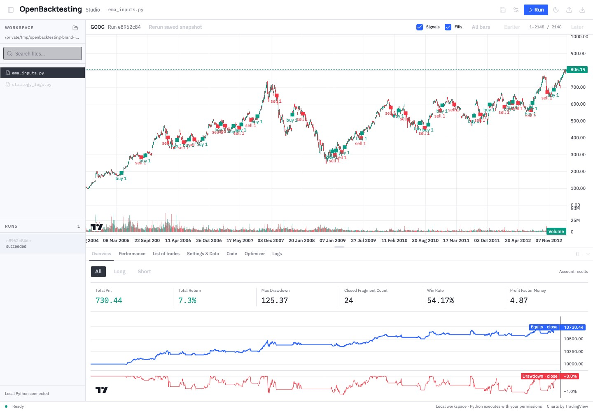

<h1>
<picture>
  <source media="(prefers-color-scheme: dark)" srcset="../assets/brand/wordmark-white.svg">
  
</picture>
</h1>

**Python 历史回测：从策略规则到可检查的回测结果。**

[English](../../README.md) · **简体中文** · [Español](README.es.md) · [Português (Brasil)](README.pt-BR.md) · [Français](README.fr.md) · [Deutsch](README.de.md) · [Italiano](README.it.md) · [हिन्दी](README.hi.md)

编写逐根 K 线执行的策略，使用历史行情进行回测，并检查订单、交易、权益及风险统计。OpenBacktesting 是独立的 Python 包，提供指标、参数优化、Portfolio 报告和绘图数据导出。

**Python 3.12–3.14** · **版本 0.2.1** · 分发包名和导入名：`openbacktesting`

[快速开始](#quick-start) · [使用手册](https://docs.openbacktesting.com/) · [示例](https://docs.openbacktesting.com/examples/) · [反馈问题](https://github.com/lucidcog/openbacktesting/issues)

[](../core/_static/studio/backtest-results-light.jpg)

## 顶级赞助商 — Pineify

<a href="https://pineify.app">
  
</a>

**[Pineify](https://pineify.app) 是 OpenBacktesting 的顶级付费赞助商。** 其资金支持用于资助本项目。

Pineify 是一套 AI 交易工具集，支持为多个平台创建指标与策略，集成了 Pine Script AI、Finance Agent、AI 选股、市场筛选、图表分析和 MCP 工具。[了解 Pineify →](https://pineify.app)

## 主要功能

- **编写策略**：使用逐根 K 线执行的生命周期、带类型的输入、内置指标和可组合的辅助函数。
- **检查执行过程**：查看订单、成交、仓位规模、费用、已平仓交易和未平仓批次。
- **分析结果**：读取 pandas 统计数据、权益曲线和每次运行的不可变 Portfolio 报告。
- **比较参数**：运行网格搜索或可选的 SAMBO 优化，保存实验结果，并为自己的渲染器导出绘图数据。

<a name="quick-start"></a>

## 快速开始

安装 [uv](https://docs.astral.sh/uv/getting-started/installation/)，使用 Python `>=3.12,<3.15`，在终端执行：

```sh
git clone https://github.com/lucidcog/openbacktesting.git
cd openbacktesting
uv sync --locked
uv run --locked python examples/advanced/run_author.py
```

示例使用包内附带的 GOOG 历史数据，无需下载行情。输出包含收益率、交易次数、最大回撤及结果表格。详细步骤见[第一次回测](https://docs.openbacktesting.com/quickstart/)。

也可以将已检出的源码安装到现有 Python 环境：

```sh
python -m pip install .
```

基础依赖为 NumPy、pandas 和 `pandas-ta-classic==0.8.32`。使用 SAMBO 优化时，执行 `python -m pip install '.[optimize]'` 或 `uv sync --locked --extra optimize`。以上为源码安装方式，不假定项目已发布到 PyPI。[构建与分发说明](https://docs.openbacktesting.com/development/)。

## 最小回测示例

将以下代码保存为仓库根目录下的 `quickstart.py`，运行 `uv run --locked python quickstart.py`：

```python
from openbacktesting import Backtest, Strategy
from openbacktesting.test import GOOG


class BuyAndHold(Strategy):
    def init(self):
        pass

    def next(self):
        if self.bar_index == 0:
            self.buy(qty=1)


result = Backtest(GOOG, BuyAndHold, end_policy="close_at_last_close").run()
print(result[["Return [%]", "# Trades", "Max. Drawdown [%]"]])
```

策略在第一根 K 线请求买入一个单位。默认在下一根 K 线开盘时成交；`close_at_last_close` 在最后一根 K 线收盘时平掉剩余仓位。

`run()` 返回 pandas Series。通过 `result["_trades"]` 读取交易，通过 `result["_equity_curve"]` 读取权益历史。完整字段和 Portfolio 导出见[结果指南](https://docs.openbacktesting.com/guides/results/)；下划线开头的字段属于原生诊断数据，尚非稳定的跨语言数据契约。

## 文档

[使用手册](https://docs.openbacktesting.com/)

详细手册和示例目前使用英文。

| 主题 | 参考资料 |
| --- | --- |
| 入门 | [第一次回测](https://docs.openbacktesting.com/quickstart/) · [示例索引](https://docs.openbacktesting.com/examples/) |
| 策略与数据 | [策略生命周期](https://docs.openbacktesting.com/guides/author/) · [行情数据](https://docs.openbacktesting.com/guides/data/) · [核心 API](https://docs.openbacktesting.com/reference/core/) |
| 指标 | [指标目录](https://docs.openbacktesting.com/reference/indicators/) |
| 执行与优化 | [运行策略](https://docs.openbacktesting.com/guides/runtime/) · [参数实验](https://docs.openbacktesting.com/guides/optimizer/) |
| 结果与绘图 | [结果及 Portfolio](https://docs.openbacktesting.com/guides/results/) · [绘图数据导出](https://docs.openbacktesting.com/guides/plotting/) |
| 开发 | [验证与构建](https://docs.openbacktesting.com/development/) · [当前限制](https://docs.openbacktesting.com/limitations/) |

## 能力范围与兼容性

- 交易模型为**单资产、单结算币种**。Portfolio 报告描述单次运行，不是多资产组合账户。
- 本包提供计算结果和绘图数据，**不包含图表渲染器、实盘交易引擎、代码沙箱或 Pine Script 转换器**，也不承诺与 Pine 具有相同语义。仅运行可信的策略代码。
- Windows 支持及完整的 Pine 对比尚未通过验证。执行与市场模型的边界见[当前限制](https://docs.openbacktesting.com/limitations/)。

分发包名和导入名均为 `openbacktesting`，不提供旧名称入口。引用旧模块路径的 pickle 不会自动迁移，带有旧品牌标识的归档不保证可读，使用旧执行身份创建的实验需要重新运行。[迁移与来源说明](https://docs.openbacktesting.com/development/#provenance-and-behavioral-boundaries)。

## 获取帮助与参与贡献

通过 [GitHub Issues](https://github.com/lucidcog/openbacktesting/issues) 提交缺陷、问题和功能建议。请附上 Python 与包版本、最小复现示例，以及预期行为和实际行为。欢迎通过 [Pull Request](https://github.com/lucidcog/openbacktesting/pulls) 贡献改进。

提交代码变更前，请运行：

```sh
uv sync --locked --extra test
uv run --locked python -m pytest
uv run --locked python -m openbacktesting.test
uv run --locked python scripts/check_package.py
```

完整检查流程见[开发指南](https://docs.openbacktesting.com/development/)。公开行为变更需同步更新文档、可运行示例和执行验证。代码、注释及技术文档默认使用英文；README 译本属于有意提供的本地化内容。

## 翻译

[英文 README](../../README.md) 是内容基准。现有简体中文、西班牙语、巴西葡萄牙语、法语、德语、意大利语和印地语译本。可通过顶部导航切换语言，更新时请遵循[翻译维护指南](TRANSLATING.md)。各语言版本的命令、API 标识符、能力边界和赞助商说明应保持一致。

## 许可证与来源

项目声明的许可证为 [Apache-2.0](../../LICENSE)。第三方材料保留其原有许可条款，包括[指标参考数据](../../tests/fixtures/indicator_expansion/README.md)。
