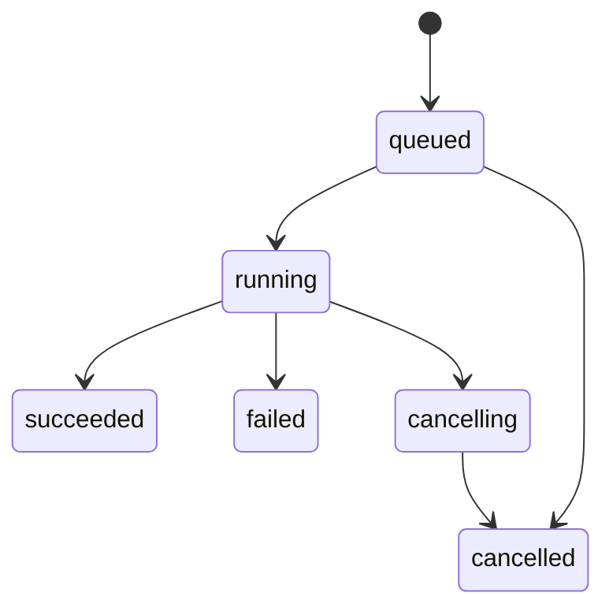

## Context

动机和能力范围见 [proposal.md](proposal.md)。当前框架只有 Python 依赖，并已有冻结的 Portfolio／PlottingResult、参数 schema 和接收已加载命名空间的运行时。`runtime.run` 不负责文件加载、数据获取、HTTP、后台任务或持久化。既有语义见 [runtime](../../../../docs/core/reference/runtime.md)、[inputs](../../../../docs/core/reference/inputs.md)、[plotting](../../../../docs/core/reference/plotting.md)、[portfolio](../../../../docs/core/reference/portfolio.md)。

用户已明确约束：同仓轻量 monorepo、Studio 独立安装、前端静态资源内置、TradingView 设计参考、shadcn/ui 基础组件、完整复制最新稳定版 Lightweight Charts 并允许修改源码补齐功能。所有设计决定须同时保护框架独立使用和 Studio 使用两条路径。

本文中的目录、命令、协议字段和容量默认值均为待实施设计，不表示当前仓库已提供这些能力。外部图表库版本沿用研究时的事实作为参考，复制时重新查验最新稳定版本。

## Goals / Non-Goals

**目标：**

- 同一次计算的程序化导出、图形展示和保存结果使用一致事实，UI 不重新定义盈亏、交易次数或统计方法。
- 让文件版本、参数版本、数据版本与运行身份形成可检查的关系；代码变化不污染已完成结果。
- 在当前用户信任的本地工作区内运行 Python，隔离运行生命周期和 HTTP 进程，准确表达取消、失败、提前终止和缺失产物。
- 首版完整支持框架现有绘图与参数语义；性能优化只改变展示粒度，不改变原始事实。
- 以可独立发布的软件包建立边界，避免依赖仓库源码路径才能运行。

**非目标：**

- 不提供任意陌生 Python 的安全沙箱、远程访问、多租户、登录账号或协同编辑。
- 不替代 Python IDE，不默认接入语言服务器，不运行 Pine Script，也不嵌入 TradingView 的完整 Strategy Tester。
- 不在本次实现多运行对比、实盘下单、实时数据、通用数据市场或高级手工画线工具。
- 不改变框架成交、统计、指标就绪或数据时区语义；不自动把表单值写回 Python 默认值。

## Decisions

### D1. 同仓双 Python 包与独立 Web 工程

采用以下逻辑结构，根目录框架保持原位：

```text
openbacktesting/
├── pyproject.toml
├── src/openbacktesting/
├── tests/
├── studio/
│   ├── pyproject.toml
│   ├── src/openbacktesting_studio/
│   │   ├── cli.py
│   │   ├── host/
│   │   ├── workspace/
│   │   ├── execution/
│   │   ├── artifacts/
│   │   ├── protocol/
│   │   └── web/                 # 生成的运行资源
│   ├── web/
│   │   ├── package.json
│   │   ├── package-lock.json
│   │   └── src/
│   │       ├── components/ui/
│   │       ├── features/
│   │       ├── chart/
│   │       └── protocol/
│   ├── vendor/lightweight-charts/
│   ├── vendor-metadata/
│   └── tests/
└── docs/
```

目录表示职责划分，不要求一开始创建空模块。Studio 分发名为 `openbacktesting-studio`，Python 导入根为 `openbacktesting_studio`，环境变量以 `OPENBACKTESTING_STUDIO_` 开头。它通过显式版本范围依赖框架，不能把框架源码复制进 wheel。开发可以使用 editable 安装，但安装验证必须离开源码目录。

根目录 wheel 只包含框架；根目录 sdist 保留框架既有开发材料，不包含 `studio/`、图表源码或前端运行产物。Studio 自己的 sdist 包含必要 Python 源码、测试、构建配置、来源记录和预构建 Web 资源，使安装 sdist 不要求 Node。完整图表源码留在仓库；维护者发布流水线从源码构建，验证产物与来源，再组装分发包。不能在用户 `pip install` 时访问 npm 或 CDN。

备选方案：先分仓会增加接口与版本协调；单一 Python 包会把 Web 依赖带给纯框架用户；完整工作区编排工具当前收益不足。因此先不引入 Nx／Turborepo，也不强制迁移为 `packages/`。

### D2. 发布、CLI 与离线资源

目标安装命令：

```bash
pip install openbacktesting
pip install openbacktesting-studio
```

目标启动入口：

```bash
openbacktesting-studio /absolute/workspace
openbacktesting-studio /absolute/workspace --python /absolute/venv/bin/python --no-open
openbacktesting-studio view /absolute/run.obstudio --no-open
```

启动时不自动加载工作区；显式参数或启动目录仅作为目录选择器的初始位置。用户在 UI 浏览或输入目录并确认后才加载文件及该目录的历史，选择路径保存到浏览器 `localStorage` 的 `studio.workspace`。同源重新打开时恢复选择，目录失效则提示重新选择；切换前必须保存草稿并结束或取消活动运行。首次启动使用已有当前解释器。`--python` 选择策略执行环境，不静默安装其依赖；先探测 Python、框架和 worker 协议兼容性，失败时给出可执行的安装说明。工作进程需要可导入兼容的 Studio worker 模块，不能只因该解释器安装了框架就宣称可运行。

服务默认绑定 `127.0.0.1:8765`，保持浏览器来源稳定以恢复 localStorage；`--port 0` 可要求系统分配端口，其他端口须显式指定。端口冲突则报错，不结束其他服务。localStorage 按协议、主机和端口隔离，不承诺跨端口共享选择。默认打开系统浏览器，`--no-open` 只输出入口。首版拒绝非回环绑定。`view` 模式不建立源码写入或执行 API，无须策略依赖；使用相同报告与图表组件。

前端采用 React、TypeScript、Vite、shadcn/ui 和 Monaco；Python 服务采用 FastAPI。依赖在实现开始时核验支持范围并锁定。将图表、编辑器 Worker、字体和图标等必需资源本地化，网络不可用时仍能打开已保存结果；需要网络的用户策略和数据源不承诺离线。

记录 wheel 下载大小、安装后包大小、全新环境总依赖体积和首屏资源量。懒加载用于减少首屏加载量，不冒充安装包减重。拒绝打包 Node.js、`node_modules`、浏览器或 Electron。

### D3. 本地会话、工作区与 HTTP 边界

每个服务实例使用一个随机会话凭证；浏览器先手动选择工作区，再通过 localStorage 记住目录。切换目录必须等待当前执行结束并保留原目录历史，旧工作区身份请求被拒绝。启动链接可通过 URL fragment 携带一次性交换凭证，前端兑换后清除 fragment，由服务设置仅本机同源使用的 HttpOnly、SameSite 会话 Cookie。凭证不得放在查询参数、普通访问日志、结果包或持久化配置中。

即使是只读文件和结果 API 也校验会话；写入与执行操作额外校验 Origin 和反跨站请求令牌。Host 仅接受启动时公布的回环主机和端口，不开放通配 CORS。静态资源响应采用明确的内容类型和适配本地编辑器 Worker 的 CSP，不允许策略文本成为 HTML 或脚本。

文件接口仅接受相对工作区路径，规范化后校验真实路径归属。拒绝越界、符号链接逃逸、设备文件和内部状态目录写入；禁止任意 shell、绝对路径执行或浏览器自选解释器。允许编辑 UTF-8 Python 文件和明确的项目文本文件，二进制和超限文件提供解释，不乱码覆盖。单文件编辑上限初始为 2 MiB，可由本地启动配置调整；实际界限在握手中返回。

本地用户代码仍有当前操作系统用户的权限；以上边界限制 HTTP 接口，不构成 Python 沙箱。服务关闭会停止排队任务，处理正在运行的进程，刷新运行索引并关闭端口。

### D4. 版本化宿主协议

统一前缀 `/api/v1`；握手返回 `protocolVersion`、Studio／框架版本、工作区标识、模式、解释器状态、能力和限制。以下为协议分组，不要求把框架内部对象直接变成响应：

| 操作 | 目标接口 | 关键约束 |
| --- | --- | --- |
| 会话与能力 | `POST /session`、`GET /capabilities` | 凭证交换、协议兼容、服务能力、只读模式 |
| 文件列表和内容 | `GET /files`、`GET /file?path=...` | 路径受限，返回内容版本，不枚举工作区外文件 |
| 保存文件 | `PUT /file` | `path`、`baseRevision`、内容；版本不符返回冲突 |
| 发现策略 | `POST /discover` | 指定源快照与入口，返回描述和诊断；不在 HTTP 进程导入 |
| 数据配置和预设 | `GET/PUT /profiles/...`、`GET/PUT /presets/...` | 版本化、原子写入、明确有效配置 |
| 提交与取消 | `POST /runs`、`POST /runs/{id}/cancel` | 固定请求、幂等键、终态不可逆 |
| 状态和事件 | `GET /runs/{id}`、`GET /events?after=...` | 有序事件、可重连、不假装有逐 K 线进度 |
| 结果读取 | `GET /runs/{id}/summary`、`/trades`、`/chart`、`/provenance` | 使用固定运行 ID，分页和范围参数稳定 |
| 导入与导出 | `POST /imports`、`GET /runs/{id}/export` | 只接受数据容器，不执行代码；限制大小和路径 |

错误统一为 `{code, message, fieldErrors, details, requestId}`，保留框架错误类别但不泄露会话密钥。`message` 默认英文，用户值与策略日志原样保留。至少区分路径拒绝、文件冲突、schema 过期、无效参数、数据错误、队列满、解释器不兼容、运行失败、产物损坏和协议不兼容。HTTP 状态采用 400／403／404／409／413／422／429／500 中对应类别。

选择 HTTP 请求加 SSE 单向状态事件；首版不需要双向 WebSocket。SSE 断线后以事件序号补读，历史已过期时重新请求状态。日志和事件有上限，截断时明确说明，不能丢事件后仍显示完整历史。

### D5. 文件编辑、冲突与固定源码

编辑器区分：磁盘已保存版本、浏览器未保存草稿、正在运行的源快照、当前展示结果的源快照。文件打开时返回内容哈希和修订标识；保存时使用 `baseRevision`，在每个路径的宿主写入锁内再次读取校验，经同目录临时文件与原子替换完成写入，保留权限和可支持的换行形式。拒绝符号链接目标，并在写入前复核父路径。

检测到外部变更时：无草稿则更新缓冲区；有草稿则保留双方内容并显示差异，可重新加载或合并后按新版本保存。不得自动覆盖。文件监听只是提示机制，不能替代保存时校验；不能声称可以完全锁住任意外部程序的写入竞态。

`Save & Run` 按顺序执行：保存当前编辑文件 → 构建执行快照 → 用该快照发现 schema → 校验当前参数 → 入队。保存或发现失败时不提交运行。只改参数而无草稿时可直接 `Run`。不自动执行每次按键，不隐式把表单覆盖写回 `inputs` 声明。

执行快照包含策略入口、工作区内本地 Python 依赖和配置指定的附加资源。首版以明确源根和排除规则捕获其中全部普通 `.py` 文件，避免仅追踪静态 import 导致漏掉动态导入；附加资源由用户明确列入。排除虚拟环境、版本控制目录、Studio 状态目录和缓存，不扫描全盘。对复制前后内容身份复核，变化则重试或报冲突，不能把两版内容拼成一次运行。

快照运行使用其源根进行模块加载，保留包结构；设置明确工作目录和环境。项目外依赖、外部文件或网络读取记录为非封闭依赖，不承诺自动复现。源码快照路径与工作区路径建立映射，错误定位指向对应文件；结果中的源码与当前文件不同时展示只读快照。

### D6. 策略发现、Inputs 与配置版本

使用新工作进程加载快照命名空间，调用 `runtime.describe`；保持“当前模块中恰好一个直接装饰的具体策略”规则，不猜测多个候选。导入、语法和依赖异常均返回可定位诊断。发现过程可能执行模块顶层代码，因此也适用超时和取消。

按 schema 的声明顺序生成控件：

| 输入类型 | 交互与序列化 |
| --- | --- |
| `int`、`float` | 有 options 时使用选择器，否则数值控件；保留空草稿，提交前解析类型、有限性和范围；`step` 是调整增量，不额外发明整除校验 |
| `bool` | 开关或复选框，必须提交布尔值 |
| `string` | 文本框或 options 选择器，保留用户文本 |
| `enum` | 使用 schema 的成员信息，提交成员名，不能提交 Python 对象或显示标签 |
| `price` | 有限数值输入，支持在图上选价后回填表单 |
| `time` | 日期时间输入，按显式时区编辑，提交 Unix 毫秒；支持图上选时 |
| `session` | 时段与星期配置并可编辑规范字符串；UI 不自行过滤行情 |
| `color` | 带透明度的颜色控件，保留八位颜色值，不能丢弃 alpha |

`group`、`inline`、`tooltip` 决定布局；`active` 引用布尔标题控制可编辑状态，递归依赖按框架规则计算。禁用输入保留并校验值。`display` 只控制状态栏／数据窗口信息，不能隐藏 Inputs 控件。`confirm` 在首次加入该配置时引导确认；价格／时间图上拾取以草稿形式回填，不能直接触发交易或默默运行。

预设保存 `schemaVersion`、`schemaHash`、标题键的 `values`，有效快照由框架返回。schema 变化后阻止自动提交，按标题、类型和约束对照显示可复用、缺失及失效值，用户应用确认后生成新请求；不单凭属性名或相近标题迁移。图表样式、视口与布局是展示状态，不能混进策略输入。

### D7. 执行属性与最小数据配置

执行设置直接映射 `runtime.describe(...).backtest.settings`，区分默认值与稀疏覆盖；数量类型、佣金类型或滑点类型改变时一并提交对应值。界面显示明确单位，尤其区分佣金百分点、spread 比例、basis points 与价格距离。仓位、成本和期末策略由框架解释。

数据配置首版提供内置示例和本地 CSV，另提供明确注册的本地 Python loader 入口，满足已有数据准备流程；不自动下载行情。loader 在工作进程中运行并返回 DataFrame，周期、时区和品种规则仍由配置显式提供。

每个数据配置记录：来源类型与相对路径／入口、列映射、时间列及编码单位、源时区、目标 `DataContext` 时区、周期单位与倍数、品种字段、选定起止范围、loader 的 JSON 参数和资源声明。起止范围采用闭区间并在 UI 标明；先按明确的时间语义解析，再切片得到实际范围。空区间直接报错。

时间必须可明确定位；CSV 无时区字符串需要源时区，夏令时重复或不存在的时间要求明确消歧，不猜测。保留排序与唯一性检查，不静默排序、去重、修正价格或插值。周期声明不触发自动重采样；改变回测周期必须提供匹配数据配置。自定义列保留并进入数据指纹，避免只哈希 OHLC 而漏掉策略依赖。

入队时固定 CSV 等原始来源文件、loader 源码及其已声明资源；loader 函数在任务进入 running 后才执行，取消排队任务不触发 loader。加载阶段生成实际 DataFrame 的不可变快照和数据身份，随后才进入回测阶段。排队期间原路径的修改不改变已经捕获的本地来源；loader 的未声明外部读取只能标为非封闭来源，不承诺冻结。

数据快照采用带 dtype、空值掩码、时区和列信息的 JSON 清单加无对象数组格式，读取时禁用 pickle；不得将不受支持的对象列静默字符串化。来源文件和规范化数据身份都记录；运行后源文件变化不改变历史结果。框架校验仍是最终依据，宿主只提前提供更容易定位的数据错误。

### D8. 独立进程、队列与取消

每个工作区首版串行执行，一个活动任务，最多 8 个等待任务；超限返回 `QueueFull`。发现与数据预检也使用受管短进程，不进入服务进程。选择串行是为了限制初期资源竞争和取消复杂度，不改变框架未来的并行能力。

请求固化后分配 `runId`；重复幂等键加相同请求返回原运行，不同请求复用同一键则冲突。入队身份包含源码、schema、数据来源快照、设置和解释器；实际 DataFrame 身份在 loading 阶段确定一次并加入运行记录，不回写改变原请求身份。所有兼容性在策略生命周期开始前检查，不能从当前 UI 状态临时取值。



运行中阶段单独记录 `loading`、`validating`、`executing`、`exporting`、`persisting`，不要以未知工作量虚构百分比。`succeeded` 表示框架返回有效结果且必要报告已持久化，不代表请求范围全执行；以 Portfolio 的执行终止信息表达提前终止。

宿主通过不经过 shell 的参数列表启动新进程，结构化 IPC 与 stdout／stderr 分离。每次运行新建解释器进程与 `RunLogs`，不复用策略实例。工作进程成功后从同一个 result 导出 Portfolio 与 PlottingResult，不允许独立重跑各自生成它们。导出后验证严格 JSON、schema 和运行关联。

Portfolio 是成功运行的必要报告。框架在执行期间因绘图采集限制抛错时，运行按框架失败处理；若回测已正常返回，只有可选 PlottingResult 的导出或大小校验失败，则保存有效 Portfolio 并把图表产物标为不可用，显示具体诊断，不能声称该次图表已经完整交付。关闭绘图采集的导入结果采用相同可用性表达。

取消以宿主串行状态事务为准：已完成并原子提交的成功终态保持成功；先接受取消的任务进入 `cancelling`，之后收到的成功结果不能覆盖取消。先发出可支持的取消信号，初始宽限期 3 秒，再终止进程树并等待回收；终止失败保留 `cancelling` 及诊断，不能在进程仍运行时报告取消成功。平台实现分别处理 POSIX 进程组与 Windows 进程树。

发现默认超时 30 秒；运行超时由本地配置显式设置，默认不设置总时长上限。硬终止可能丢失尚未传回的结构化日志，必须标明。stdout／stderr 默认各保留 1 MiB 尾部，完整输出如未保存不得暗示可恢复。服务重启后，未终结记录转为带 `host_restarted` 原因的失败记录，不伪装恢复仍存在的进程，也不自动重跑。

### D9. 运行存储、不可变结果与只读查看

工作区内使用 `.openbacktesting/studio/` 保存本地配置、预设、运行索引和产物；不自动修改策略源码或把这些数据加入 Git。文档提供显式忽略规则。只读 `view` 模式使用用户缓存目录，不能在原档案旁擅自写文件。

运行索引使用 SQLite 管理状态与可查询元数据，文件产物按 `runs/<runId>/` 独立存储。大数据不反复塞进索引。临时目录写完后校验大小和摘要，原子发布产物清单，再提交索引；启动恢复核对两者，未完整提交的运行不出现在可用成功列表。

| 产物 | 内容与关系 |
| --- | --- |
| `manifest.json` | Studio 容器版本、运行状态、代码／配置／数据／环境身份、可用能力、产物摘要和诊断 |
| `portfolio.json` | 原样保留公开 Portfolio 结构与版本，不平铺丢失 metric 元信息 |
| `plotting.json` | 可选的完整 PlottingResult，保留轴、mask、事件、feature 与执行信息 |
| `description.json`、`request.json` | 执行时的参数定义、覆盖请求、有效参数与设置 |
| `logs.json`、输出文件 | 已获得的结构化日志与有界 stdout／stderr，含截断标记 |
| `source/` 与数据快照 | 明确保留的源码、依赖、数据及其摘要；可在分享导出时省略 |

`manifest.schemaVersion`、宿主协议版本、Portfolio 版本、PlottingResult 版本各自独立。拒绝无法理解的主版本或未知必需特性；未知可选字段可以保留而不解释。不可通过读取 `_strategy` 或其他可变 Python 对象重新导出旧结果。

完整导出使用 `.obstudio` 容器（ZIP，清单加严格 JSON 和可选资源）。默认分享导出仅含报告、图表和必要元数据，不含源码、原始数据与完整日志；用户显式选择后才加入，导出前展示目录、体积及来源信息范围。没有源代码的结果必须仍可读。无原始数据时明示不能保证重跑，不从当前工作区补入同名文件。

导入支持完整容器，也支持独立 Portfolio JSON 和可选配对的 PlottingResult JSON，为纯框架用户提供路径。单个 Portfolio 可直接只读查看；无共同运行身份的手工配对必须经轴、上下文和成交事实一致性校验并标明来源未完全验证，不仅凭文件名相同就建立可信关联。

导入限制条目数量、展开后总字节、单文件大小与压缩比，拒绝绝对路径、`..`、符号链接条目、重复文件名、摘要不符、可执行反序列化格式和不支持的主版本。所有源码文件仅当作文本，不 import、不 eval、不运行 pickle。初始展开总上限 512 MiB，可本地配置；超限必须在受限临时区安全失败。

重新执行是创建新运行并记录 `parentRunId`；只有依赖和数据都可验证时才启用一键复现。安装不同版本的环境要显式提示差异，不能覆盖旧运行。`runtime.optimize` 的旧试验只有 Portfolio 时，可以查看报告，不能宣称图表或源代码已经存在。

### D10. 完整图表源码的纳管与构建

实施时从官方上游核验最新非预发布稳定 tag，解析到不可变 commit，将该 commit 完整文件树纳入 `studio/vendor/lightweight-charts/`。不能仅复制 `src/` 或打包后的 JS。来源 URL、tag、commit、引入时间和全文件摘要清单放入独立 `vendor-metadata/`，保持原始树与本地修改可比。

本地修改使用常规 Git 变更并在变更日志中关联目的和回归用例，不能删除上游测试来假装兼容。保留许可证、NOTICE、版权和其他必需声明；分发时展示 TradingView 署名链接。上游源码及文档保留原语言，不为本项目语言检查批量翻译。

前端构建显式依赖本地库产物；依赖锁文件和构建检查拒绝误用 registry 中另一个同名版本或 CDN。发行包包含编译结果及来源版本摘要，开发页可查看实际构建的上游版本与本地修订。

优先复用现有 API／图元，但只要无法精确表达已确定语义，就修改库的类型、模型、布局、绘制或交互实现。完整源码由我们维护意味着接纳合并与回归成本，不能把“上游限制”改写为产品降级条款。升级单独提交，在相关检查通过前保留已有稳定构建。

### D11. 图表数据映射与全部绘图语义

前端图表模块只接收经过版本校验的普通数据，构造规范化视图模型，图表实例不持有策略对象。图表布局、数据解码、降采样、拾取与事件命中分离，使数值映射可通过纯函数测试证明。

| 框架语义 | 必须实现的视图行为 |
| --- | --- |
| `market` OHLCV | 主图蜡烛；成交量独立 pane；没有有效成交量时说明缺失，不伪造零量 |
| `panes`、`scales` | 主图与声明顺序的副图，独立纵轴，共享横轴；副图可调高和收起，切换运行不混入旧引用 |
| line／step | 保留曲线或阶梯形式、颜色和标题；无效或未就绪值不参与可见区间纵轴缩放 |
| histogram | 保留 baseline、正负方向与基线对纵轴范围的贡献 |
| level | 水平常量线，按该 pane 的量纲和范围显示 |
| fill | 同 pane 兼容边界之间的区间填充，处理交叉、gap 与 alpha；不画成普通底部面积图 |
| `gap_policy` | `break` 真正断开；`connect` 只连接允许连接的有效点，不能把缺失点补成零 |
| `offset_bars` | 按 K 线位置偏移，保留显示所需未来槽位；不能改变实际数据或计算时间 |
| marker | 保留 circle／square／triangle_up／triangle_down、文字、颜色和精确价格定位 |
| `anchorBar`／`knownAtBar` | 图形位置与获知时间分别保留，详情可解释确认滞后 |
| `bar_color` | 同时覆盖烛身、影线与边框，完整保留透明度；None 恢复默认，按事件顺序最后写入有效 |
| `bg_color` | 按目标 pane 和当前 K 线绘制背景，None 清除当根覆盖，不跨 K 线继承 |
| 实际成交与策略标记 | 独立图层、图例和开关；真实成交使用 fill ID、价格、方向、数量和费用 |

所有当前 `requiredFeatures` 必须覆盖。未来文件含未知必需特性时，显示明确的不兼容状态，不能把部分图形伪装成完整渲染；有效 Portfolio 仍可读。这是版本兼容错误，不是放弃本次已确定的绘图能力。

行情横轴保留权威的 `barIndex` 与时间标签映射。能无损映射为原生时间时可使用原生轴；纳秒碰撞、ordinal 或无时区轴采用自定义横轴／本地源码扩展，按精确条目身份排序，标签由原始值生成。JavaScript 保留纳秒字符串或 BigInt，不先转 Number 再补救。不对 ordinal 伪造日期，不对 naive 时间强加 UTC；Studio 新运行要求 aware 数据，而导入结果仍须准确展示其他已支持轴种类。

跨 pane 默认共享图表横轴；独立权益图根据原始 bar 范围映射，而非直接复制不同采样序列的 logical index。事件同步带来源标识和循环保护；鼠标离开清除共享十字光标。价格／时间拾取服务于参数草稿，不能与交易标记点击混淆。

### D12. 权益、交易和报告语义

报告的数值唯一来源是 Portfolio。用 `report_catalog()` 建立字段元数据映射，按照 `value/unit/methodId/status/reason` 格式化；null 显示为 `—`，可查看原因，不能以 0 替代。比例转百分数仅发生在格式化层；货币遵循品种和报告信息，没有币种就不假定美元。

默认报告分为 `Overview`、`Performance`、`Trades`、`Settings & Data`，诊断进入独立 `Logs`。界面英文标签遵循仓库默认策略，用户策略标题与日志保留原文。概览展示净盈亏、总收益、回撤、交易数、胜率、利润因子等已支持字段；详细指标支持 all／long／short，但不把方向贡献当作独立账户。

默认权益曲线来自 `series.close`；同一 bar 的 terminal 观测作为最后显示点或独立标注，并保留普通收盘详情。`series.account` 中 `ordered=False` 的盘中极值只能作为范围／边界，不连接成虚构路径。显示使用的曲线口径，指标回撤来自不同采样口径时一并说明；不从降采样线条重算统计。

`Trades` 区分 closed fragments、open lots、orders、fills 和 allocations。成交与交易行均有稳定原始 ID，部分平仓不偷偷合并为一笔完整 lot；可在详情中沿分配关系跳转。点击行定位图表并突出关联事件，不能仅凭相同 timestamp 选中错误的一次成交。分页、排序与筛选基于原始事实，空状态有明确含义。

`Settings & Data` 同时展示代码／数据／配置身份、请求范围与实际执行范围、期末处理、手续费、滑点、时区、版本与可复现性限制。当前编辑器草稿或配置与显示结果不同，顶部显示 `Out of date` 和差异来源；运行失败时可保留上一份成功报告，但必须保留旧 run ID 与过期标识。

### D13. 数据规模与展示精度

初期结果全量保存在磁盘，HTTP 按需返回概要、分页事实和当前图表窗口。每次图表请求包含 run ID、源 bar 范围、图层集合和可视目标点数，响应返回实际范围、聚合等级与原始 ID 映射。

OHLCV 聚合使用首／高／低／末／和并记录原始桶边界。权益和回撤保留末值与极值，指标默认用保留时间顺序的首／末／极值视图，不任意取均值掩盖交叉；所有聚合均标明粒度，缩小到原始范围后恢复精确值。marker、fill、颜色变更等事件不能按普通连续数值线压缩；密集事件聚合为可展开数量，保留全部原始 ID。

光标和交易详情查询使用原始事实。所有图表操作不重新执行策略、不改变 metrics。取消旧视口请求或只应用最新 request sequence，避免慢响应覆盖用户的新视口。缓存键包含 run ID、轴、范围、图层与聚合策略，不能跨运行复用不匹配数据。

初始宿主默认分页为 100、最大 1000，图表目标点数默认 5000，可协商但受上限约束；这些是请求预算，不是最大数据容量承诺。大文件不在浏览器一次解析整个 Portfolio；超过配置限制时提供可执行的调整方式，不静默截断执行数据。性能验证先测量序列转换、接口响应与构建包大小，实际目标硬件数据决定后续调优。

### D14. TradingView 参考与 shadcn/ui 设计系统

桌面布局以图表为主：顶部含策略、数据和运行状态；中央市场主图和副图；可通过按钮切换到底部或右侧、可拖拽调整比例的编辑器／报告／Optimizer／日志区；参数和执行属性使用清晰分组的设置对话框或侧栏；左侧文件区可收起。窄窗口保留工作流，以区域切换代替把所有面板挤在一起，不强求手机完整 IDE。

统一使用 shadcn/ui 的按钮、表单、Tabs、Dialog、菜单、表格、Tooltip、滚动和分隔组件。组件缺少的复合交互在同一设计系统内组合，语义化原生 HTML 可以作为底层，但不以浏览器默认外观交付。以语义 token 管理背景层级、边框、字体、间距、圆角、密度、盈亏色和状态色；图表、Monaco 与控件使用统一明暗主题，默认跟随系统并保存用户偏好。

TradingView 参考具体落实为紧凑工具栏、图表优先、多面板联动、设置表单对齐、概要到明细的报告层级，不承诺像素级复制。禁止堆叠默认卡片而忽视图表可用区域。数字列右对齐，金额和比例格式一致；盈亏不能只靠颜色表达。

键盘可访问主要运行、保存、设置和标签切换；弹窗有初始焦点、返回焦点、可读错误关联，禁用和运行中状态能被辅助技术识别。图表同时提供可读的数据／交易详情路径。保存快捷键在编辑器上下文内工作，不劫持整个浏览器所有快捷键。

### D15. 语言、第三方来源与既有检查

本变更的中文研究和 OpenSpec 是用户明确授权的规划内容；代码注释、默认 UI 与诊断保持英文。修改语言策略时保留既有多语言用户输入与测试，不能全目录跳过检查来掩盖默认文案。

为每个批准的规划文档登记具体路径、目的和内容身份，归档后更新明确路径；vendored 文件用上游文件清单和哈希识别原文，本地修改仍需记录归属与理由。第三方原文不为通过项目语言规则而改写。现有 provenance 清单覆盖到的文件若修改，更新目标摘要和改动说明，原始来源摘要不重写。

包身份检查区分核心 import 根、伴生包 import 根和第三方库本身，不把第三方模块错误改名为 `openbacktesting`。保留禁止旧项目名的既有要求；若完整上游树中发生实际冲突，准确报告并单独决策，不能静默删文件或放宽全局检查。

### D16. 验证分层与完成证据

本提案遵循 openspec-propose 技能的验证约束：默认不要求浏览器集成、Playwright／Cypress、截图或真实浏览器操作。规格中的交互场景是行为契约，优先用纯数据转换、状态模型、HTTP 和进程测试证明；不得把未执行的 UI 行为说成已验收。

| 层次 | 默认验证与证据 |
| --- | --- |
| 规划 | `openspec validate add-openbacktesting-studio --strict`，能力目录、需求、场景与任务交叉检查 |
| 前端静态 | 在 Web 工程定义并执行 `typecheck`、`lint`、`build`；验证 shadcn/ui 使用、主题 token 和本地图表构建依赖 |
| 语义与状态 | 无浏览器的转换单元测试、schema 表单状态测试、图表配置与事件映射、分页／降采样不变量 |
| 宿主 | HTTP 测试客户端、临时工作区、实际短子进程；覆盖路径、冲突、取消、重启恢复、导入和日志界限 |
| 图表源码 | 相关上游静态检查、构建和可在无浏览器环境运行的测试，加本地语义回归；不把全部上游浏览器套件自动升级为本变更必需项 |
| 分发 | 干净 Python 环境分别安装核心与 Studio wheel／sdist，离开仓库运行，关闭浏览器自动打开，核对资源、版本和最小回测 |
| 既有框架 | 受影响的输入、运行时、Portfolio、Plotting 和纯结果接口回归；修改 provenance／生成源时执行对应完整性检查 |

完成记录区分已实现、已通过、未执行和不在范围内，不以构建成功替代语义证明；如后续用户要求浏览器流程验证，再增加明确范围的任务。

## Risks / Trade-offs

- [完整上游树增加仓库与维护成本] → 固定来源、维护本地修改记录、版本升级单独审查，发行 wheel 只含运行产物。
- [Python 顶层代码、loader 或策略可能挂起或修改外部状态] → 明确本地可信代码模型，独立进程和可终止生命周期；不声称 OS 沙箱隔离。
- [源码快照不能捕获所有外部依赖] → 保存实际输入数据、环境与声明资源，标注非封闭依赖；不凭哈希声称可重建不存在的数据。
- [编辑器和外部工具写入竞争] → 内容版本检查、受管路径锁、原子保存、明确冲突；不依赖单一文件监听事件。
- [指标单位和时间轴适配错误] → 权威契约与纯函数回归，保留 nanoseconds／bar ID，终止观测与无序极值有独立规则。
- [第三方组件升级破坏图表语义] → 运行相关回归并固定可追溯版本，不让无修改的远程包替换本地源码。
- [Studio 安装引入错误 Python 环境] → 明确解释器探测与兼容性诊断，真实安装包验证，不在 UI 自动升级用户环境。
- [首版范围大] → 分阶段交付内部可用版本，但完成判定覆盖所有已确定类型、图形和状态；不得用“不支持”替代收尾。
- [没有真实浏览器验证证据] → 精确报告静态与模型验证的范围；本次不自动承诺交互像素效果已得到浏览器验证。

## Migration Plan

1. 先建立 Studio 包、Web 工程和协议版本，保持根目录框架的安装与测试不变。
2. 引入并记录完整上游图表源码，打通可重复构建，再开发数据映射与 UI。
3. 完成固定源码、配置、执行和产物链路；以已有公开接口生成可供图表与报告使用的数据。
4. 完成全部参数、绘图和结果语义，再整合编辑器与 TradingView 参考布局。
5. 在干净环境验证两包、离线静态资源及无 Node 运行，补充用户文档和实际验证记录。
6. 不自动迁移现有脚本或优化实验；用户可继续原有框架工作流，或显式导入结果进入 Studio。
7. 回退时卸载 Studio 即可继续使用框架；用户 `.py` 修改和本地结果保留。存储版本升级前备份，旧版本无法理解的新主版本只读拒绝，不破坏原文件。发布上传属于后续明确操作，不包含在实施默认动作中。

## Open Questions

- 具体锁定的最新 Lightweight Charts 稳定 tag 在源码引入任务执行时确定，不改变完整源码纳管和功能补齐原则。
- 包体积和实际资源预算需要首个构建测量；本文给定请求默认值可据测量调整，但必须保持显式上限和不丢事实的不变量。
- 明暗主题的具体颜色数值与间距 token 在组件基础任务中确定，不改变 TradingView 参考与 shadcn/ui 必须采用的约束。


## Optimizer 与日志展示补充决策

Optimizer 紧随 Code 标签页，使用同一 shadcn 组件、字体、主题和区域切换机制。后端直接封装公开 `runtime.optimize`、`runtime.resume_optimization` 与 `ExperimentResult`，不重算或简化核心指标。预览固定源码、规范化数据、参数和执行身份；Start 单独确认开始试验。参数域支持九种类型的 Values，以及 int／float／price 的 Range，十进制范围保持字符串精度。约束是快照模块中的命名函数，函数名与源码摘要进入身份。

普通运行和优化共享工作区执行槽。每个实验使用独立进程，按核心串行穷举语义提交试验。取消先协作、超时后终止进程；重启标记中断。恢复验证同一份源码、数据、环境和配置，已提交失败不自动重试。数据库保存每个成功试验的完整 Portfolio；打开试验报告不重新执行。图表与日志不属于核心优化产物，界面不虚构这些资源。

结果查询暴露全部标量字段、单位、状态与方法，多字段排序、七种过滤运算和游标分页；游标保持提交水位直到主动刷新。All trials 独立显示成功、失败、约束跳过与尝试次数。数据库以核心 backup 一致性导出；导入后只查询，不执行未提供的源码。应用试验参数需要匹配当前 schema，进入配置审阅后才能另行运行。

Logs 参考 TradingView 官方 Pine logs 文档，按时间、级别、文本显示；支持级别、来源、起始时间和文本搜索，搜索可选择大小写、完整词、正则。正则无效时保留消息并提示。源码按钮读取对应运行快照，bar 按钮定位原始 K 线。历史回测日志没有实时采集开关；缺失或截断如实标记，不伪装成完整实时日志。
